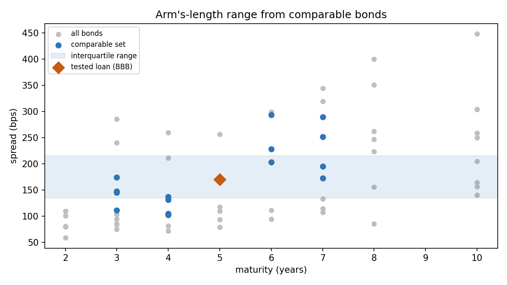

# Credit rating & interest-rate benchmarking

How much interest should a subsidiary pay its parent on an intra-group loan?
This repo answers that the way a transfer-pricing or treasury reviewer would
check it: rate the borrower from its own ratios, lift the rating for group
support, read a spread off a rating/tenor curve, and confirm the result against
the interquartile range of comparable bonds.



## What it does

| Step | Module | Output |
|---|---|---|
| Ratio scorecard: EBITDA margin, debt/EBITDA, EBITDA/interest, FFO/debt, size, each mapped to a rating by threshold and weighted into one score | `credit/scorecard.py` | `outputs/scorecard.csv` |
| Stand-alone rating → supported rating (implicit group support, capped at the group rating, OECD TPG Ch. X) | `credit/scorecard.py` | `with_implicit_support()` |
| Spread curves by rating and maturity: log-linear across tenor, one third of a bucket per notch across ratings | `credit/curves.py` | `outputs/spread_grid.csv`, `spread_curves.png` |
| Rate build-up: base rate (currency, tenor) + spread + security / subordination adjustments | `credit/curves.py` | `price_loan()` |
| Arm's-length range: interquartile range of comparable bonds (rating ±1 notch, maturity ±2 years) | `credit/curves.py` | `outputs/comparables_selected.csv`, `comparables.png` |
| Sensitivity: all-in rate across support notching × tenor | `run.py` | `outputs/sensitivity_lift_x_tenor.csv` |
| Excel workbook with **live formulas** (scorecard interpolation, notching, curve lookup), recalculated and checked against Python | `credit/excel.py` | `outputs/credit_benchmark.xlsx` |

## Run it

```bash
pip install -r requirements.txt
python run.py                  # illustrative case in data/base_case.json
python -m pytest tests         # 9 tests: ratios by hand, threshold interpolation, notching cap, curve monotonicity, rate identity, comparable filter
```

For a listed borrower, pull the scorecard inputs from its statements and fill
in the judgement calls (group rating, tenor, security):

```bash
pip install yfinance
python scripts/fetch_financials.py SAP.DE > data/sap.json
python run.py data/sap.json
```

## Base case result

Illustrative EUR 50m, 5-year senior unsecured loan from a Luxembourg holding to
an operating subsidiary (`data/base_case.json`):

```
Weighted score          4.62
Stand-alone rating      BB+
Group rating            A-   -> implicit support lift 2 notches
Supported rating        BBB

Base rate (EUR 5y)      2.550%
Credit spread (BBB)     170 bps
All-in rate             4.250%

Comparable bonds        n = 15, IQR 134-216 bps (median 172)
                        -> curve-based spread sits inside the arm's-length range
```

Three things a reviewer would look at first, and which the outputs make visible:

1. **Leverage and coverage carry half the weight.** Debt/EBITDA of 4.0x and
   EBITDA/interest of 5.5x are what pull the stand-alone rating down to BB+;
   margin and size matter less.
2. **The support notching is worth ~95 bps.** Lifting BB+ to BBB moves the
   5-year rate from 5.20% to 4.25% (`sensitivity_lift_x_tenor.csv`). Whether
   the parent would really stand behind the subsidiary is the key judgement in
   the file, and the sensitivity table shows exactly what it is worth.
3. **The market check passes, but barely.** The curve point (170 bps) sits just
   below the comparable median; the stand-alone BB+ spread (~265 bps) would sit
   outside the range, so the support argument has to hold.

## Data

All market data in `data/` is **illustrative** so the repo runs offline and
reproducibly: `spread_curves.csv` is a stylised EUR corporate spread matrix,
`base_rates.json` a stylised swap curve, and `comparable_bonds.csv` a synthetic
bond set generated around those curves. To use the model for real, replace them
with observed data on the pricing date and keep the same column layout. The
scorecard thresholds in `scorecard_grid.json` follow the shape of agency
industrial methodologies and should be calibrated to the borrower's sector.

## Layout

```
credit/scorecard.py   ratios -> factor scores -> notched rating; group-support notching
credit/curves.py      spread interpolation, base rates, rate build-up, comparable IQR
credit/excel.py       live-formula workbook + LibreOffice recalculation check
run.py                end-to-end run, charts and CSV outputs
tests/                pytest suite
scripts/              yfinance helper for real borrowers
```
